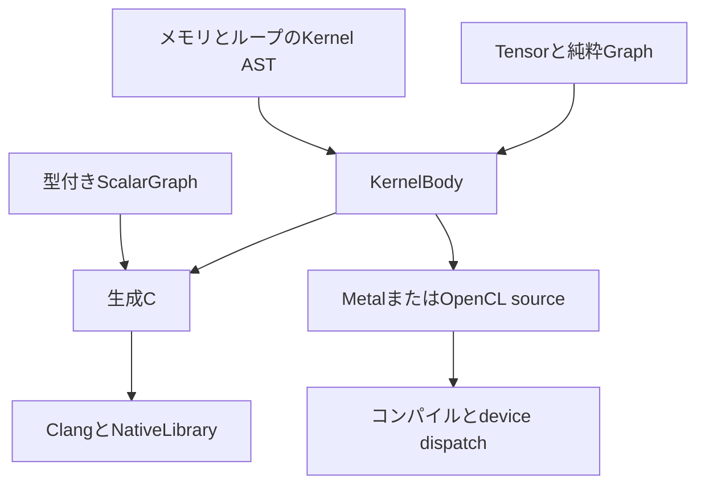

# chibigrad の全体構成

この教材は、Rustでグラフを構築し、計算コードを生成して実行するMLコンパイラを作ります。[入口](00-roadmap.md)から01〜25章を順に進めます。各章の指定付きコードが実装全体であり、別の完成ソースをダウンロードする手順にはしません。

## フロントエンドと実行経路

最初に小さいscalar compilerを作り、用途に応じた表現へ広げます。型付きscalarとscopeは `ScalarGraph`、明示的なメモリ効果と有限ループは `kernel`、shape付きの純粋なTensor式は `Graph` が扱います。異なる表現を一つのenumへ無理に詰めず、共通のnative backendへ接続します。

05〜07章のKernel ASTと08章以降のGraphは `native::KernelBody` とCのentry rendererを共有します。Graphはshapeを実行時metadataへ変換し、構造化したCのloopとindexを出します。Kernel ASTは書込み順、viewの範囲、初期化状態、RANGEのscopeを検証してから同じbackendへ渡します。有限の確認量を超えた場合は未検証として拒否します。

`Tensor` はGraphの所有先とNodeIdを持つ入口です。演算構築時には数値計算を実行しません。`Graph::compile` が `Plan` を作り、`Plan::run` へ実行時の `Buffer` を束縛します。matmulとconvはmovement、乗算、縮約の合成です。

## 署名、所有権、検証

CPUの論理ABIはbuffer pointer配列とu64 scalar word配列です。f32の実行時scalarはビット列としてpackし、Tensorの実行では各ノードのshape metadataをwordへ入れます。CPU entryは整数statusを返します。これは入力を検証してから呼ぶための、02章で示すABIです。

scalarの署名は到達するPARAMから検証します。shape付きGraphのPlanは宣言された全入力slotを署名へ残します。これにより定数になった勾配にも、元のparameterと入力を同じslotで渡せます。個数、rank、shape、容量、添字を呼出し前に検査します。コンパイル後の公開metadataを変更しても、所有するbinaryの契約は変わりません。

`NativeLibrary` はロード済みhandleと一時ディレクトリを所有します。Dropで先にlibraryを閉じ、続いて一時ファイルを削除します。raw Cのコンパイル・ロードとraw symbolの取得にはunsafe契約があり、通常のGraph利用者は検証済みのPlanを使います。GPUのraw program実行も、生成source、binding、scalar、geometryに対するunsafe契約を持ちます。

GPUはGraphと同じ `KernelBody` の座標・maskを使い、出力位置をgroupとlaneへ変換します。deviceとpipelineの資源制限、引数設定、完了待ち、status、読出しまでruntimeが所有します。数値がCPUと一致しても、GPUを実行していなければ実機確認は未実行です。

## 学習、モデル、実行時shape

逆伝播は元のGraphへ勾配の純粋な式を追加します。共有値の寄与を加算し、broadcastやmovementを逆向きに戻します。勾配も同じcompilerで実行し、有限差分は比較先に使います。SGDとAdamWの更新は実行時parameterを入力に持つgraphです。

`Registry` は名前と一意のparameter ID、alias、入力slotを管理します。保存state、optimizer、乱数状態、datasetの位置を検証してから採用します。公開重みは固定revision、長さ、SHA-256を検証して読みます。Qwenは小fixtureから、全24層、tokenizer、prefill、KV cache、全parameterの学習へ広げます。

20章の `ShapeProgram` は既存Graphにshape式を対応させます。scopeを持つ変数・式のIDを使い、一回のBindingsを変更不能なsnapshotにします。logical shapeと物理容量を分け、generic binaryを再利用します。固定条件を満たす場合だけ別にcompileした特化版を選びます。

## 最適化と確認の境界

09章のfusionは単一消費先の要素演算をinline化し、STAGEとfanoutをmaterializeします。17〜19章ではloop分割、ベクトル化、CPU thread、local reduction、GEMM tile、workspaceとcacheを追加します。23章は学習用の通常attentionを残して推論用FlashAttentionを選び、25章は実際のcapability probeで行列命令を有効にします。

性能値はcompile、転送、実行、同期を分けて記録します。sourceを生成できること、bindingがビルドできること、実機で正しい値を返すこと、性能が改善することは別の確認です。

## 参照と再現

元の697項目は [requirements.json](requirements.json) に原文とIDを保存します。`tools/replay_docs.py` が見出し、コード配置、保存操作、確認コマンドを検査します。最終的な実装はMarkdownからのみ展開し、章順に実行できます。

比較対象となるtinygradは隣のcheckoutへの各章のリンクから読めます。tinygradの実装をそのまま転写するのではなく、教育用に表現とbackendの責務を分けています。特に独自ELF loader、HCQ全体、任意のsymbolic方程式、可変rankは対象に含めません。
