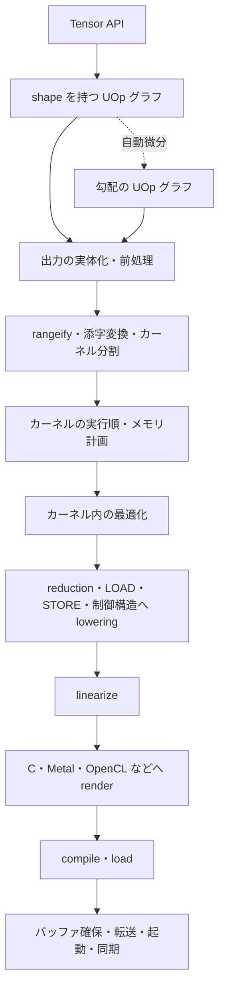

# chibigrad の設計と段階的な実装計画

tinygrad の本質を、小さな Rust 製コンパイラを動かしながら理解できる教材にするための計画。

解析対象は tinygrad の commit `c22edff14c79310a9b2df62a78819cf77c8289fa`。解析日は 2026-11-08。

[Compilers for Machine Learning のシラバス](https://gist.github.com/geohot/4768597d9dc536446ee2d5de1f29e89d)を参考に、共通の UOp を中心として、メモリ、ループ、shape、fusion、自動微分、GPU を順に加える。各章を小さなコミットに分け、最初のコミットからコード生成と実行まで通す。

この文書では、現行 tinygrad のコードから確認した動作と、教育用の chibigrad に提案する設計を区別する。リンク先のソース行番号は解析対象の commit に対応する。

実装は [詳細 TODO の入口](00-roadmap.md) から進める。元の11章を小さな実行可能な単位へ分割し、各手順に tinygrad のソース対応、追加するデータ、小コミット、期待値、完了確認を記した。Gist の内容を扱うため、後半の第12〜15章を追記した。初版の静的 f32、CPU・Metal・OpenCLという方針は維持する。

## tinygrad のコンパイラとしての流れ



次の二つを分けて考える。

- 計算全体を何個のカーネルに分割し、どの順に実行するか。
- 一つのカーネルで、どんなループとメモリアクセスを実行するか。

前者は fusion、中間バッファ、カーネル間の依存関係を扱う。後者はループ分割、GPU スレッドへの割当、累積変数、命令の順序を扱う。

### 各段階とソースコードの対応

| 段階 | 実際に行うこと | 主な入口 |
|---|---|---|
| Tensor の式を作る | 演算を実行せず、UOp グラフを組み立てる | [Tensor._apply_uop](../../tinygrad/tinygrad/tensor.py#L103) |
| 出力を実体化する | 必要な出力に保存先を用意し、計算と STORE を結び付ける | [Tensor.linear_with_vars](../../tinygrad/tinygrad/tensor.py#L165) |
| カーネルを作る | shape を添字に変換し、materialize する場所とカーネル境界を決める | [get_kernel_graph](../../tinygrad/tinygrad/schedule/rangeify.py#L341) |
| 実行順を決める | バッファの読み書きの依存を満たす順に並べる | [create_schedule](../../tinygrad/tinygrad/schedule/__init__.py#L31) |
| メモリを計画する | 中間バッファの生存期間に基づいて保存領域を再利用する | [memory_plan_rewrite](../../tinygrad/tinygrad/schedule/memory.py#L19) |
| カーネルを下げる | ループを最適化し、reduction、添字、ロードなどを具体化する | [full_rewrite_to_sink](../../tinygrad/tinygrad/codegen/__init__.py#L269) |
| コードにする | 順序付きの命令列、ソース、バイナリを作る | [do_to_program](../../tinygrad/tinygrad/codegen/__init__.py#L487) |
| 実行する | コンパイル、リンク、バッファの解決、起動を行う | [run_linear](../../tinygrad/tinygrad/engine/realize.py#L284) |

現在の tinygrad は、この広い範囲で `UOp` を使う。保存する基本情報は `op`、`src`、`arg` であり、dtype はそこから導出する。同じ構造のノードを共有する hash-consing も行う。[UOp の定義と共有処理](../../tinygrad/tinygrad/uop/ops.py#L181)

共通の UOp を使うことと、全段階で同じ意味のグラフを扱うことは別である。Tensor の段階では shape 付きの演算を表し、後段では具体的な添字、ループ、メモリアクセスを表す。

### 融合した計算の実行例

CPU の Clang 経路で、次の式を実行して確認した。

```python
from tinygrad import Tensor, dtypes

x = Tensor([1., 2., 3., 4.], dtype=dtypes.float32, device="CPU").realize()
w = Tensor([2., 3., 4., 5.], dtype=dtypes.float32, device="CPU").realize()

y = (x * w + 1).sum()
y.realize()
```

入力を実体化した後にカウンタをリセットすると、式を作った段階での実行カーネル数は `0`、`y.realize()` 後は `1`、結果は `44.0` だった。生成された C でも、乗算、加算、総和を一本のループで処理していた。

Tensor の演算一つごとにカーネルを起動しているわけではない。出力の計算に必要な入力と添字をたどり、同じカーネルにまとめている。

### 行列積も少数の演算から作れる

行列積もフロントエンドの専用命令を必須にはしていない。通常の `matmul` は、reshape、transpose、broadcast を伴う乗算、sum の組合せになる。[dot の実装](../../tinygrad/tinygrad/mixin/op.py#L390)

この性質は教材に向いている。少数の演算と添字変換があれば、行列積の意味まで説明できる。その後、同じ計算を高速に実行する方法を別の章にできる。

## chibigrad の最初の仕様

| 項目 | 最初の仕様 |
|---|---|
| shape | コンパイル時に確定する静的 shape |
| データ型 | 計算用に `f32`、添字用に `i32`、条件用に `bool` |
| 配置 | row-major の連続バッファ |
| 実行 | 単一デバイス、同期実行 |
| 更新 | 入力を破壊せず、新しい出力を作る |
| CPU | C を生成して system clang でコンパイルする |
| GPU | 出力一要素を一つの work item が計算する |

### Rust での UOp の持ち方

tinygrad の `arg` に相当する情報を、型付き enum の payload にすると扱いやすくなる。以下は設計の概形であり、完成した実装ではない。

```rust
struct NodeId(u32);

enum Op {
    Const(Scalar),
    Param { slot: usize, dtype: DType },
    Add,
    Mul,
}

struct UOp {
    op: Op,
    src: Box<[NodeId]>,
}

struct Graph {
    nodes: Vec<UOp>,
    intern: HashMap<NodeKey, NodeId>,
}
```

メモリ、ループ、shape の章で `Op` の variant を追加する。

`Vec<UOp>` にノードを追加し、参照を `NodeId` で持つ。最初からノードごとに `Rc<RefCell<_>>` を持たせる必要はない。

dtype、shape、address space は導出関数として持ち、必要なら結果をキャッシュする。浮動小数点定数を hash のキーにするときはビット表現を使い、NaN と符号付きゼロの扱いを明確にする。

バッファと allocation には固有の ID が必要である。同じ shape の配列を二つ作っても、同じ保存先になるわけではない。また、ロードやストアの共有では、対象バッファの状態と依存関係を考慮する必要がある。

### 段階ごとにグラフを検証する

共通 UOp を使う場合は、段階ごとの verifier が特に役立つ。

| 段階 | 確認すること |
|---|---|
| scalar graph | 入力数、dtype、演算の引数が正しい |
| shaped graph | broadcast、reshape、reduction の軸が成立する |
| kernel graph | バッファ参照と添字、ループ範囲が成立する |
| lowering 後 | movement と抽象的な reduction が残っていない |
| linearize 後 | 変数の利用位置とループのスコープが正しい |
| backend 入力 | 対象が扱える演算だけが残っている |

shape が正しいことと、メモリアクセスが範囲内であることは別である。静的に確認できないアクセスは、ガードを生成するか、未対応として拒否する方針にする。

## 段階的な実装手順

「章」は固定の週数ではなく、動作を確認できる区切りとする。各章の中でもコミットを分け、その時点で利用できる入力から実行結果まで毎回確認する。

### 1. scalar のグラフを C にして実行する

詳細手順は [01. scalar の C 生成](01-scalar-c.md) と [02. 実行時入力](02-runtime-inputs.md) を参照する。最初は定数 `7` をコンパイルして実行し、その後に加算・乗算と実行時入力を追加する。

この章では、定数の出力から始め、scalar の入力、加算、乗算を追加する。Rust で `(a+b)*c` のグラフを作り、rewrite、linearize、C renderer、コンパイル、実行まで通す。

この段階の rewrite は入力をそのまま返して構わない。linearize も依存順の走査で十分である。各段階を通る経路が実際に存在することを優先する。

`a,b,c` は実行時の入力にする。入力 `2,3,4` に対して `20`、`5,1,2` に対して `12` を返すことを確認する。同じ生成済みコードを、入力値を変えて再利用できる状態にする。

最初は生成 C を実行ファイルにしても構わない。次章以降で共有ライブラリ方式に進めれば、初回から動作を見られる。

到達点は、最小のグラフがコード生成と実行まで通ることである。

### 2. UOp の共有、interpreter、rewrite を加える

詳細手順は [03. UOp と書き換え](03-uop-rewrites.md) と [04. 関数と STACK](04-functions-stack.md) を参照する。

まず hash-consing を追加し、同じ入力から作った同じ演算が同じ `NodeId` になることを確認する。

次に scalar UOp を評価する interpreter を作る。これは以降のコード生成と最適化の比較先になる。C で実行する経路も残す。

rewrite は bottom-up の単純な走査と `match` から始める。最初から tinygrad の `UPat` 相当の DSL やパターンコンパイラを作る必要はない。

定数畳み込みを追加し、書き換え前の interpreter、書き換え後の interpreter、生成 C の結果を比較する。

浮動小数点の規則は慎重に選ぶ。`x*0 → 0` は NaN や無限大で意味が変わる。`x+0` も符号付きゼロの扱いが変わる場合がある。最初は添字の整数式と、意味を定めた定数畳み込みを中心にする。

コミットは、ノード共有、interpreter、最初の rewrite の順に分ける。

### 3. メモリと CPU runtime を実装する

詳細手順は [05. メモリと runtime](05-memory-runtime.md) を参照する。

バッファ、固定添字、LOAD、STORE を導入する。まずは `out[0] = x[2] + 1` をコンパイルし、入力 `[10,20,30]` に対して `31` を返す。

次のコミットで、複数バッファと複数要素を扱う。まだループがなくても、短い固定長の処理を展開すれば動く。

ここで C を共有ライブラリとしてコンパイルし、Rust から固定の C ABI で呼び出す。例えばバッファポインタの配列を渡す方式なら、演算ごとに Rust 側の関数型を増やさずに済む。

ロード済みライブラリは、カーネルを使用している間保持する。FFI とポインタ操作は CPU runtime にまとめる。

STORE を導入した時点で、実行順も表現する。最初は明示的な順序を持たせ、後に `AFTER` で「この書込みが終わった後のバッファ」を表せるようにする。

到達点は、実際のバッファを読み書きする生成コードが Rust から実行できることである。

### 4. ループを実装する

詳細手順は [06. ループ](06-loops.md) と [07. 累積と手書きカーネル](07-scalar-reductions.md) を参照する。

`RANGE` と `END` を導入し、展開していたベクトル加算を一本のループに変える。

次のコミットで累積変数を使い、`sum([1,2,3,4]) = 10` を動かす。この時点では高水準の `REDUCE` は不要であり、手でループと累積を組み立てる。

さらに二重ループを追加し、行和を計算する。

```c
for (int row = 0; row < 2; row++) {
	float acc = 0.0f;
	for (int col = 0; col < 3; col++) {
		acc += x[row * 3 + col];
	}
	out[row] = acc;
}
```

`[[1,2,3],[4,5,6]]` が `[6,15]` になることを確認する。累積の初期化が外側ループの内側にあることも確認する。

単純なトポロジカルソートだけでは、累積の初期化とループのスコープを決められない。最初は構造化されたループ本体を一時的に持ち、そこから順序付き UOp を生成する方式で十分である。

この段階なら、添字を手で書いた GEMM も実装できる。後の章で、同じループを shape 付きの式から自動生成する。

コミットは、単一ループ、累積、二重ループと行和、手書き GEMM の順に分ける。

### 5. 一次元の shape、REDUCE、rangeify を加える

詳細手順は [08. shape と rangeify](08-shapes-rangeify.md) を参照する。

ここで「長さ N の配列の加算」を、高水準の UOp として表す。これまではループを直接書いていたが、今度は compiler がループを作る。

最初は演算ごとに中間バッファと別カーネルを作る。`x*2+1` に `[1,2,3]` を渡して `[3,5,7]` が返ればよい段階である。

次に、出力要素の添字を入力側へ伝える rangeify を実装する。

```text
出力の i 番目を求める
    ↓
add の i 番目を求める
    ↓
mul の i 番目を求める
    ↓
x[i] をロードする
```

`REDUCE` については、出力の範囲とは別に reduction の範囲を作り、前章の累積ループに変換する。

この章の到達点は、shape 付きの演算から添字付きのカーネルを自動生成できることである。

### 6. fusion と materialization を実装する

詳細手順は [09. fusion と fission](09-fusion-fission.md) を参照する。

最初は、単一の消費先を持つ要素演算の連鎖を融合する。`(x+1)*2` の中間配列を消し、一つのループ、一つの出力バッファで計算する。

続いて reduction の入力側を融合する。`sum(x*w+1)` を一つの reduction カーネルにする。

反対に、中間結果を保存する操作も用意する。`Stage` や `contiguous` のような明示的な境界である。tinygrad でも、確認した例では `(x+1)*2` は一つ、`(x+1).contiguous()*2` は二つのカーネルになった。

複数の消費先を持つ計算は、最初は保守的に materialize する。再計算するか保存するかを選ぶ最適化は、後から追加できる。

カーネル間の実行順は、純粋な入力と新規出力だけなら依存関係のトポロジカルソートで作れる。tinygrad が扱う破壊的更新の読み書きハザードまで、ここで導入する必要はない。

コミットは、要素演算の fusion、reduction 入力の fusion、明示的な materialization、複数消費先の処理に分ける。

### 7. 多次元 shape と movement を実装する

詳細手順は [10. movement](10-movement.md)、[11. Tensor と GEMM・conv](11-tensor-gemm-conv.md)、[12. 数学関数](12-math-functions.md) を参照する。

二次元の要素演算と broadcast から始める。

```text
[[1,2,3],       [10,20,30]       [[11,22,33],
 [4,5,6]]  +               =     [14,25,36]]
```

次に reshape、permute、shrink、pad を一つずつ追加する。これらは、基本的には出力座標を入力座標に変換する操作として扱う。

現行 tinygrad でも、reshape は座標をいったん論理的な一次元位置にし、除算と剰余で元の座標へ戻す。permute は座標を並べ替え、shrink は offset を加え、pad は有効範囲の条件を作る。[添字変換の実装](../../tinygrad/tinygrad/schedule/indexing.py#L146)

次のテストを含める。

```text
[[1,2,3], [4,5,6]]
    → transpose
    → reshape([6])
    → [1,4,2,5,3,6]
```

shape と strides の付け替えだけで任意の reshape を扱おうとすると、このような非連続配置で難しくなる。最初は対応できない reshape を連続化し、後に座標変換の合成へ進めても構わない。

pad では、無効なメモリアクセスを実行しないことが必要である。範囲外をロードした後でゼロを選んでも安全にはならない。

この章で Tensor API を薄いラッパーとして追加する。さらに reshape、broadcast、乗算、sum の組合せで matmul を実装する。次を到達点にする。

```text
[[1,2,3],      [[1,2],      [[22,28],
 [4,5,6]]  @    [3,4],  =   [49,64]]
                [5,6]]
```

コミットは、多次元要素演算、broadcast、各 movement、Tensor API、合成演算としての matmul に分ける。

### 8. 自動微分と小さな学習を実装する

詳細手順は [13. 自動微分](13-autodiff.md) と [14. SGD と MNIST](14-sgd-mnist.md) を参照する。

微分は、rangeify より前の純粋な shape 付きグラフで行う。ループや STORE を微分する必要はない。

まず加算と乗算の微分を実装し、逆トポロジカル順に勾配を伝える。共有ノードには複数の経路から来る勾配を加算する。

次に sum、broadcast、reshape、permute を追加する。broadcast の逆向きでは、増えた軸の勾配を足し戻す。現行 tinygrad でも、微分は新しい UOp グラフを作る処理である。[compute_gradient](../../tinygrad/tinygrad/mixin/gradient.py#L114)

検証には次を使う。

- `sum(x*x)` の勾配が `x=[1,2,3]` に対して `[2,4,6]` になる。
- 同じ変数を複数回使った式で、寄与が加算される。
- broadcast した bias の勾配が元の shape に戻る。
- 小さな入力で有限差分と一致する。

前向きと勾配の両方を、既存の compiler と runtime で動かす。微分専用の実行器は作らない。

次に SGD と線形回帰を追加する。最初はパラメータ更新をホスト側で行っても構わない。計算グラフと実行計画を一度作り、入力スロットに新しい重みを渡して繰り返し実行する。学習する重みを定数として畳み込まない構造にする。

chibigrad では元のグラフを保持し、実体化済みの値を別の表で管理する案を勧める。現在の tinygrad は scheduling に伴って Tensor の参照先を保存先へ更新するため、微分するタイミングにも注意が必要である。

コミットは、scalar の微分、共有ノードの勾配加算、sum と broadcast、movement の微分、SGD、線形回帰に分ける。

### 9. Metal、次に OpenCL を追加する

詳細手順は [15. Metal](15-metal.md) と [16. OpenCL](16-opencl.md) を参照する。

macOS で進めるなら、CPU の次に Metal、その後 OpenCL という順序が自然である。各 backend で、まず加算を動かし、broadcast、reduction、matmul と広げる。

最初の GPU lowering は、出力ループを hardware ID に置き換えるだけにする。

```text
CPU
  for i in 0..N:
    out[i] = ...

GPU
  i = global_id
  if i < N:
    out[i] = ...
```

行和なら一つの work item が一行を担当し、列方向は逐次ループする。matmul なら一つの work item が一つの出力要素を担当し、縮約軸を逐次計算する。

この方式なら、最初の GPU 版に shared memory、atomic、barrier は不要である。

backend ごとに、入力転送、コンパイル、起動、完了待ち、結果読出しまで確認する。要素数 `257` のように、local size で割り切れないケースも含める。

コミットは、Metal の加算、端数処理、broadcast、逐次 reduction、matmul の順に分ける。その後、OpenCL でも同じ順序で確認する。

### 10. 最適化を一つずつ追加する

詳細手順は [17. ループ最適化](17-loop-optimizations.md)、[18. 並列 reduction](18-parallel-reduction.md)、[19. 高速 GEMM・conv](19-fast-gemm-conv.md) を参照する。

最初はループ分割である。元の添字を `outer*tile+inner` に置き換え、端数のガードを生成する。次にループの並べ替え、小さな unroll を追加する。

GPU の並列 reduction は別のコミットにする。各 thread の部分和、local memory への保存、barrier、最終 reduction の順に実装する。

barrier は workgroup 内の全 thread が到達する必要がある。端数の thread を途中で return させず、無効な要素を加算の単位元 `0` として扱う。

その後で tiled matmul を実装する。共有メモリ、レイアウト、ベクトル化を同時に変更せず、各変換の前後で数値を比較する。

中間バッファの再利用やコンパイルキャッシュも、この段階で加えられる。実行計画を繰り返し使うこと自体は、それ以前から可能にしておく。

性能を測定する際は、コンパイル、転送、実行、同期のうち、どの時間を計測しているかを区別する。

### 11. 小さなモデルで機能の組合せを確認する

詳細手順は [14. SGD と MNIST](14-sgd-mnist.md) を参照する。実モデルへの拡張は第14章で扱う。

線形回帰の次は小さな MLP、その後に MNIST 程度を目標にする。小さな Transformer は拡張課題にできる。

モデルで必要な演算が増えたら、その演算の最小例を実装してからモデルに戻る。初期値と入力を固定し、出力、勾配、更新を確認する。

コンパイラ本体をコンパクトに保つなら、まずは「MLP を自動微分して CPU と GPU で学習できる」ところを前半の完成点にする。

### 12. 制約付きの symbolic shape を追加する

詳細手順は [20. symbolic shape](20-symbolic-shapes.md) を参照する。

静的 shape の経路を残し、範囲を持つ実行時サイズを追加する。変数の binding、添字の境界、確保する容量と論理的な長さ、特殊化する場合のキャッシュキーを区別する。最初は一次元の可変長の式から始める。

### 13. モデルの入出力と取得を追加する

詳細手順は [21. モデル I/O](21-model-io.md) を参照する。

小さなローカル重みファイルの保存と読込みから始める。その後に URL と SHA-256 の検証を追加し、実モデルの重みと設定、学習の checkpoint を扱う。重みの配置を計算グラフの定数へ埋め込まず、入力スロットへ binding する。

### 14. Transformer、attention、LLM 学習へ拡張する

詳細手順は [22. Transformer と Qwen](22-transformer-qwen.md)、[23. flash attention](23-flash-attention.md)、[24. LLM 学習](24-llm-training.md) を参照する。

固定した小さな Transformer の数値確認から始め、対象を明記した実 Qwen checkpoint の推論へ進む。通常の attention を比較先として flash attention を実装する。学習は小さな語彙とモデルから始め、保存・再開を含む全経路を確認する。SOTA 性能の達成は受入条件にしない。

### 15. 行列アクセラレータと拡張課題を扱う

詳細手順は [25. ハードウェア拡張](25-hardware-extensions.md) を参照する。

対応機器を判定してから、行列命令へ割り当てる最小のカーネルを追加する。通常の GEMM を比較先と fallback に残す。CPU・Metal・OpenCL に共通の行列命令が存在すると仮定せず、公開された機能のある backend を選ぶ。その後に論文の再現や別ハードウェアへの移植を独立した課題として扱う。

## backend の境界

共通の計算表現と、機器固有の実行処理を分ける。

| backend | chibigrad の実装案 |
|---|---|
| CPU | C を生成し、clang で共有ライブラリ化し、固定 ABI で呼ぶ |
| Metal | MSL から library と pipeline を作り、buffer を bind して dispatch する |
| OpenCL | source から program を build し、引数を設定して NDRange を起動する |

Metal は公開 API のソースコンパイルと通常の command encoder を使えば十分である。結果を CPU から読む前に完了を待つ。[Metal のソースコンパイル](https://developer.apple.com/documentation/metal/mtldevice/makelibrary%28source%3Aoptions%3Acompletionhandler%3A%29)、[完了待ち](https://developer.apple.com/documentation/metal/mtlcommandbuffer/waituntilcompleted%28%29?changes=_5&language=objc)

OpenCL は `clBuildProgram`、`clSetKernelArg`、`clEnqueueNDRangeKernel` を使う通常の経路にする。初版は単一の in-order queue と同期的な読出しで十分である。[program の build](https://registry.khronos.org/OpenCL/specs/unified/refpages/man/html/clBuildProgram.html)、[NDRange の仕様](https://registry.khronos.org/OpenCL/specs/unified/html/OpenCL_API.html#clEnqueueNDRangeKernel)

起動情報は `Launch { groups, local }` のように意味を明示した名前にする。現在の tinygrad の `global_size` は group 数として使われ、OpenCL 側では `groups * local` を実際の global work size にしている。[OpenCL の寸法変換](../../tinygrad/tinygrad/runtime/ops_cl.py#L64)

現在の tinygrad の Metal と OpenCL は、コマンド投入処理までホスト側 UOp に変換する HCQ2 の経路を使っている。CPU には独自の ELF ローダーもある。これらは初版の chibigrad には持ち込まず、通常の API 呼出しで実行する構成を勧める。[実行処理のコンパイル経路](../../tinygrad/tinygrad/engine/realize.py#L275)、[CPU ローダー](../../tinygrad/tinygrad/runtime/ops_cpu.py#L18)

## ファイル構成案

以下は完成時の配置案であり、最初から全ファイルを作る必要はない。各章で必要になったファイルを追加する。

```text
src/
  uop.rs             ノード、ID、intern、導出情報
  verify.rs          段階ごとの検証
  interpret.rs       比較用の実行器
  rewrite.rs         グラフの書き換え
  linearize.rs       ループと命令の順序
  shape.rs           shape と座標変換
  rangeify.rs        shape 付き計算から添字付き計算への変換
  schedule.rs        カーネル分割と実行順
  tensor.rs          利用者向け API
  autograd.rs        勾配グラフの生成
  renderer/
    c.rs
    metal.rs
    opencl.rs
  runtime/
    cpu.rs
    metal.rs
    opencl.rs
examples/
tests/
```

各コミットには、小さな入力と期待値を置く。さらに `--dump-graph`、`--dump-kernel`、`--dump-schedule`、`--dump-source` を追加すると、「式がどの添字とループになったか」を追える。

## 初版では実装しないもの

当面は次を範囲から外す。

- symbolic shape。
- 複数 GPU。
- tensor core。
- BEAM search。
- 独自 ELF ローダー。
- 高度な非同期実行。

汎用 rewrite DSL や巨大な backend trait 階層も、必要になってから導入する。

上記は前半の初版の対象外である。symbolic shape と行列アクセラレータは削除せず、第12章と第15章の後半手順で扱う。詳しい内容の対応は [Gist 対応表](00-roadmap.md#gist-の内容と対応を確認する) を参照する。

## 解析で確認した範囲

CPU の Clang 経路では、融合した総和、broadcast、行和、転置後の reshape、matmul、自動微分を数値実行で確認した。Metal と OpenCL はソース解析までであり、実機実行は確認していない。

| 確認項目 | 結果 |
|---|---|
| `sum(x*w+1)`、`x=[1,2,3,4]`、`w=[2,3,4,5]` | `44.0`、一つの計算カーネル |
| `[[1,2,3],[4,5,6]] + [10,20,30]` | `[[11,22,33],[14,25,36]]` |
| 行和 | `[6,15]` |
| 転置後に長さ 6 へ reshape | `[1,4,2,5,3,6]` |
| `[[1,2,3],[4,5,6]] @ [[1,2],[3,4],[5,6]]` | `[[22,28],[49,64]]` |
| `sum(x*x)` の勾配、`x=[1,2,3]` | `[2,4,6]` |
| `sum((x+b)*(x+b))` の bias 勾配、`x=[[1,2,3],[4,5,6]]`、`b=[10,20,30]` | `[50,94,138]` |
| `(x+1)*2` と `(x+1).contiguous()*2` のスケジュール | 前者は一つ、後者は二つの計算カーネル |

この計画の設計には poteto-mode の Foundational Thinking を適用し、共通 UOp と段階ごとの不変条件を先に決めた。Sequence work into verifiable units に沿って、各機能を実行結果まで確認できるコミットに分けた。
